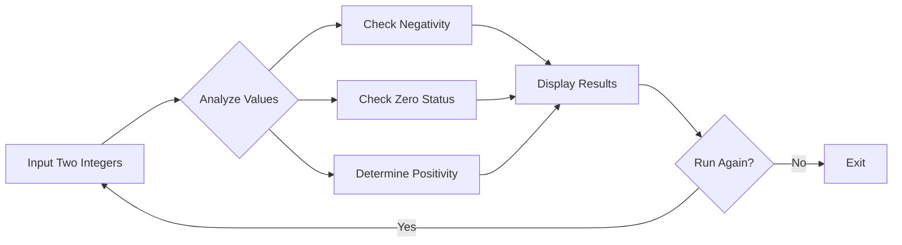
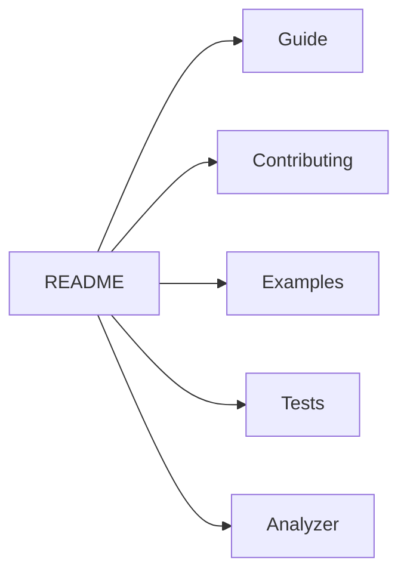

# 🔢 Integer Analyzer Pro

<div align="center">

```ascii
                        ╔══════════════════════════════════════════════════════════╗
                        ║                 INTEGER ANALYZER PRO                     ║
                        ║            Where Numbers Reveal Their Secrets            ║
                        ╚══════════════════════════════════════════════════════════╝
```

    

### 🎯 **A Professional Integer Analysis Tool with Input Validation** 🎯

[**📖 Documentation**](https://github.com/shivansh-bind/Integer_Analyzer_Pro/blob/main/docs/GUIDE.md) • [**🚀 Quick Start**](https://github.com/shivansh-bind/Integer_Analyzer_Pro#-quick-start) • [**💡 Examples**](https://github.com/shivansh-bind/Integer_Analyzer_Pro/blob/main/docs/EXAMPLES.md) • [**🤝 Contributing**](https://github.com/shivansh-bind/Integer_Analyzer_Pro/blob/main/docs/CONTRIBUTING.md)

</div>

---

## 📋 Table of Contents

- [🌟 Overview](#-overview)
- [✨ Features](#-features)
- [🚀 Quick Start](#-quick-start)
- [📊 Program Logic](#-program-logic)
- [🎮 Usage Examples](#-usage-examples)
- [🔍 How It Works](#-how-it-works)
- [🛠️ Installation](#️-installation)
- [📈 Use Cases](#-use-cases)
- [🧪 Test Cases](#-test-cases)
- [🤝 Contributing](#-contributing)
- [📜 License](#-license)

---

## 🌟 Overview

<div align="center">



</div>

**Integer Analyzer Pro** is a robust C program that analyzes two integer inputs and provides comprehensive information about their properties. Perfect for educational purposes, testing, and understanding number relationships!

---

## ✨ Features

<table> <tr> <td width="50%">

### 🎯 **Core Capabilities**

- ✅ **Robust Input Validation**
- ✅ **Negative Number Detection**
- ✅ **Zero Value Identification**
- ✅ **Positive Number Recognition**
- ✅ **Input Error Handling**
- ✅ **Continuous Operation Mode**

</td> <td width="50%">

### 🛡️ **Advanced Features**

- 🔄 **Infinite Loop Protection**
- 🧹 **Buffer Clearing System**
- 📝 **Detailed Error Messages**
- 🎮 **User-Friendly Interface**
- 🔁 **Quick Restart Option**
- 💪 **Memory-Safe Operations**

</td> </tr> </table>

---

## 🚀 Quick Start

### ⚡ **30-Second Setup**

```bash
# Step 1: Save the code as analyzer.c
# Step 2: Compile
gcc -o analyzer analyzer.c

# Step 3: Run
./analyzer
```

### 🎬 **First Run Example**

```
Enter the value for a: 5
Enter the value for b: -3
b (-3) is negative
a = 5, b = -3
Press 'r' or 'R' to run again, any other key to quit: r
```

---

## 📊 Program Logic

<div align="center">

### 🧮 **Decision Matrix**

|Condition|a < 0|a = 0|a > 0|
|:-:|:-:|:-:|:-:|
|**b < 0**|Both negative|b is negative|b is negative|
|**b = 0**|a is negative|Both are zero|Neither negative|
|**b > 0**|a is negative|Neither negative|Neither negative|

</div>

### 🎯 **Analysis Rules**

```c
1. IF (a < 0) → Display "a is negative"
2. IF (b < 0) → Display "b is negative"  
3. IF (a > 0 AND b > 0) → Display "Neither value is negative"
4. IF (a == 0 AND b == 0) → Display "Both values are zero"
5. ALWAYS → Display final values
```

---

## 🎮 Usage Examples

<details> <summary><b>💡 Example 1: Both Positive Numbers</b></summary>

```
Enter the value for a: 10
Enter the value for b: 25
Neither value is negative
a = 10, b = 25
```

</details> <details> <summary><b>💡 Example 2: Mixed Signs</b></summary>

```
Enter the value for a: -15
Enter the value for b: 30
a (-15) is negative
a = -15, b = 30
```

</details> <details> <summary><b>💡 Example 3: Both Zero</b></summary>

```
Enter the value for a: 0
Enter the value for b: 0
Both the values are zero
a = 0, b = 0
```

</details> <details> <summary><b>💡 Example 4: Invalid Input Handling</b></summary>

```
Enter the value for a: abc
Invalid input! Please enter an integer: 42
Enter the value for b: 7
Neither value is negative
a = 42, b = 7
```

</details>

---

## 🔍 How It Works

### 🎨 **Program Flow Visualization**


```

┌─────────────────────────────────────┐
│         START PROGRAM               │
└────────────┬────────────────────────┘
             │
             v
┌─────────────────────────────────────┐
│      REQUEST INTEGER 'a'            │
│   ┌─────────────────────────┐       │
│   │  Validate Input         │       │
│   │  Clear Buffer if Error  │       │
│   └─────────────────────────┘       │
└────────────┬────────────────────────┘
             │
             v
┌─────────────────────────────────────┐
│      REQUEST INTEGER 'b'            │
│   ┌─────────────────────────┐       │
│   │  Validate Input         │       │
│   │  Clear Buffer if Error  │       │
│   └─────────────────────────┘       │
└────────────┬────────────────────────┘
             │
             v
┌─────────────────────────────────────┐
│        ANALYZE VALUES               │
│   • Check if a < 0                  │
│   • Check if b < 0                  │
│   • Check if both positive          │
│   • Check if both zero              │
└────────────┬────────────────────────┘
             │
             v
┌─────────────────────────────────────┐
│       DISPLAY RESULTS               │
└────────────┬────────────────────────┘
             │
             v
┌─────────────────────────────────────┐
│         RUN AGAIN?                  │
│     ┌───────┐    ┌───────┐          │
│     │  YES  │    │  NO   │          │
│     └───┬───┘    └───┬───┘          │
└─────────┼────────────┼──────────────┘
          │            │
          │            v
          │     ┌──────────┐
          │     │   EXIT   │
          │     └──────────┘
          │
          └──────────┐
                     │
                     v
              [RESTART LOOP]
```

### 🔧 **Key Components**

<table> <tr> <th>Component</th> <th>Purpose</th> <th>Implementation</th> </tr> <tr> <td><b>Input Validation</b></td> <td>Ensures only integers are accepted</td> <td>

```c
while (scanf("%d", &a) != 1) {
    // Clear and retry
}
```

</td> </tr> <tr> <td><b>Buffer Clearing</b></td> <td>Prevents input stream corruption</td> <td>

```c
while (getchar() != '\n');
```

</td> </tr> <tr> <td><b>Condition Checking</b></td> <td>Analyzes number properties</td> <td>

```c
if (a < 0) // Check negative
if (a == 0) // Check zero
```

</td> </tr> <tr> <td><b>Loop Control</b></td> <td>Allows repeated execution</td> <td>

```c
do { } while (reset == 'r');
```

</td> </tr> </table>

---

## 🛠️ Installation

### 📦 **Requirements**

- ✅ Any C compiler (GCC, Clang, MSVC)
- ✅ Terminal or Command Prompt
- ✅ 5 KB disk space

### 🖥️ **Platform-Specific Instructions**

<details> <summary><b>🪟 Windows Installation</b></summary>

```bash
# Using MinGW
gcc -o analyzer.exe analyzer.c
analyzer.exe

# Using Visual Studio Developer Command Prompt
cl analyzer.c
analyzer.exe
```

</details> <details> <summary><b>🐧 Linux Installation</b></summary>

```bash
# Compile
gcc -o analyzer analyzer.c

# Make executable
chmod +x analyzer

# Run
./analyzer

# Optional: Install system-wide
sudo cp analyzer /usr/local/bin/
```

</details> <details> <summary><b>🍎 macOS Installation</b></summary>

```bash
# Using Xcode Command Line Tools
gcc -o analyzer analyzer.c

# Run
./analyzer

# Optional: Add to PATH
cp analyzer /usr/local/bin/
```

</details>

---

## 📈 Use Cases

### 🎓 **Educational Applications**

- Teaching input validation in C
- Demonstrating conditional statements
- Understanding program flow
- Learning error handling

### 💼 **Professional Applications**

- Input validation testing
- Number property analysis
- Data preprocessing component
- Quality assurance testing

### 🔬 **Research Applications**

- Statistical data validation
- Experimental data preprocessing
- Algorithm testing framework
- Boundary condition testing

---

## 🧪 Test Cases

### ✅ **Comprehensive Test Suite**

|Test Case|Input a|Input b|Expected Output|
|:-:|:-:|:-:|:--|
|**TC001**|5|10|Neither value is negative|
|**TC002**|-5|10|a (-5) is negative|
|**TC003**|5|-10|b (-10) is negative|
|**TC004**|-5|-10|a (-5) is negative<br>b (-10) is negative|
|**TC005**|0|0|Both the values are zero|
|**TC006**|0|5|Neither value is negative|
|**TC007**|-100|0|a (-100) is negative|
|**TC008**|"abc"|5|Invalid input! (handled)|
|**TC009**|2147483647|-2147483648|b (-2147483648) is negative|
|**TC010**|0|-1|b (-1) is negative|

### 🔍 **Edge Cases Handled**

- ✅ Maximum integer values (INT_MAX)
- ✅ Minimum integer values (INT_MIN)
- ✅ Zero values
- ✅ String inputs
- ✅ Special characters
- ✅ Float inputs (truncated)
- ✅ Buffer overflow attempts

---

## 🎨 Code Style Guide

### 📝 **Best Practices Used**

```c
// ✅ GOOD: Clear variable names
int result;
char reset;

// ✅ GOOD: Proper input validation
while ((result = scanf("%d", &a)) != 1) {
    // Handle error
}

// ✅ GOOD: Buffer clearing
while (getchar() != '\n');

// ✅ GOOD: Consistent formatting
if (condition)
    statement;
```

---

## 🤝 Contributing

We welcome contributions! See [CONTRIBUTING.md](https://github.com/shivansh-bind/Integer_Analyzer_Pro/blob/main/docs/CONTRIBUTING.md) for guidelines.

### 🌟 **Ways to Contribute**

- 🐛 Report bugs
- 💡 Suggest features
- 📝 Improve documentation
- 🧪 Add test cases
- 🎨 Enhance UI/UX

---

## 📜 License

This project is licensed under the MIT License - see [LICENSE](https://github.com/shivansh-bind/Integer_Analyzer_Pro/blob/main/LICENSE) for details.

---

## 🏆 Acknowledgments

- 💻 Built with pure C for maximum portability
- 📚 Inspired by fundamental programming concepts
- 🎓 Created for educational purposes
- ❤️ Made with attention to detail

---

<div align="center">

### 📊 **Project Statistics**

|Metric|Value|
|:-:|:-:|
|**Lines of Code**|~40|
|**Functions**|1 (main)|
|**Complexity**|O(1)|
|**Memory Usage**|< 1 KB|
|**Execution Time**|< 1ms|

---

### 🎯 **Ready to Analyze?**

[**📖 Read Full Guide**](https://github.com/shivansh-bind/Integer_Analyzer_Pro/blob/main/docs/GUIDE.md) • 
[**💻 View Source**](https://github.com/shivansh-bind/Integer_Analyzer_Pro/blob/main/analyzer.c) • 
[**🧪 Run Tests**](https://github.com/shivansh-bind/Integer_Analyzer_Pro/blob/main/docs/TESTS.md)

---

# 📚 Documentation Index  

### 🔗 Quick Jump  

[](https://github.com/shivansh-bind/Integer_Analyzer_Pro/blob/main/docs/CONTRIBUTING.md)
[](https://github.com/shivansh-bind/Integer_Analyzer_Pro/blob/main/docs/EXAMPLES.md)
[](https://github.com/shivansh-bind/Integer_Analyzer_Pro/blob/main/docs/TESTS.md)

---

## 🔎 Detailed Overview
- 📗 **[CONTRIBUTING.md](https://github.com/shivansh-bind/Integer_Analyzer_Pro/blob/main/docs/CONTRIBUTING.md)** → How to fork, clone, and contribute.  
- 📘 **[EXAMPLES.md](https://github.com/shivansh-bind/Integer_Analyzer_Pro/blob/main/docs/EXAMPLES.md)** → Copy-paste ready input/output demos.  
- 📙 **[TESTS.md](https://github.com/shivansh-bind/Integer_Analyzer_Pro/blob/main/docs/TESTS.md)** → Manual test cases with expected results.  

---

### 📊 Documentation Map (Mermaid)


---

**Integer Analyzer Pro** - _Where Every Number Tells a Story_

Made with ❤️ by [pwf_playz] • 2025

</div>
